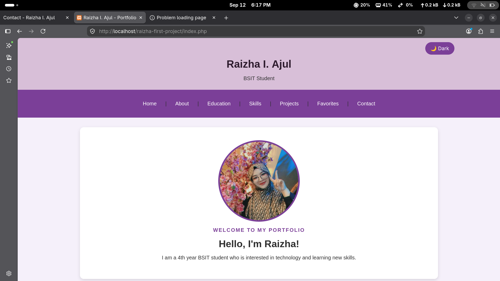
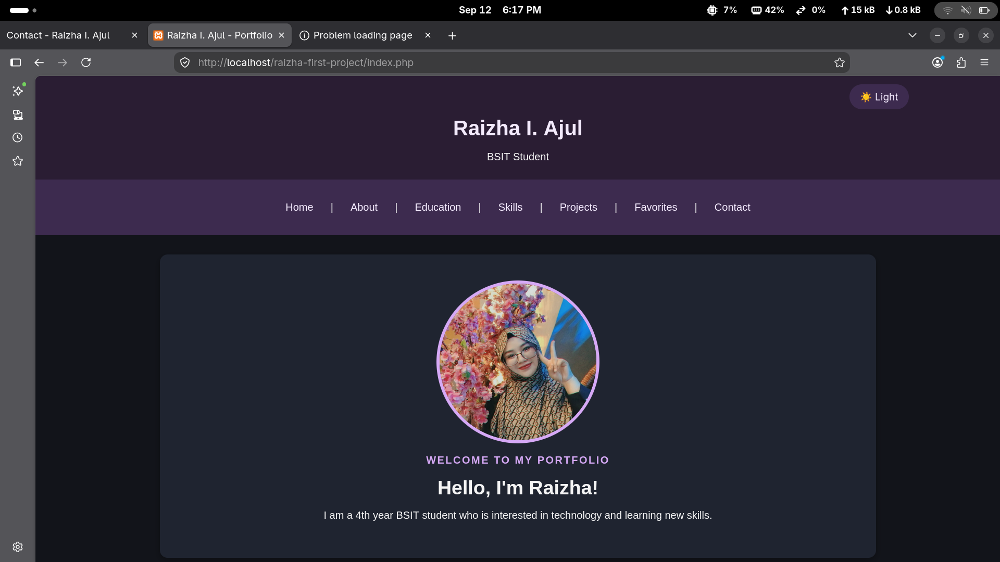
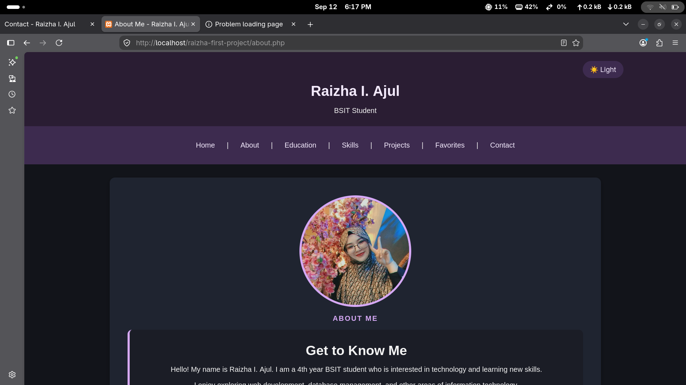
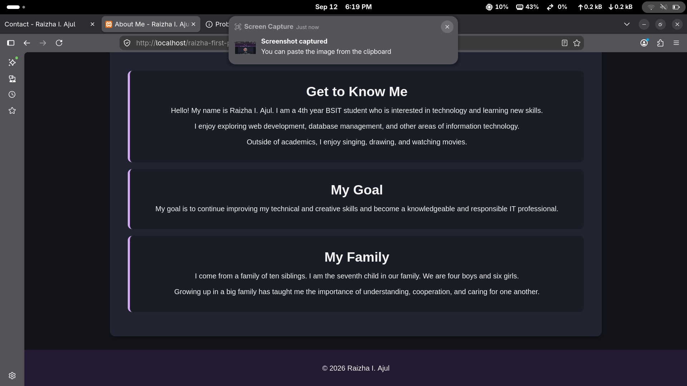
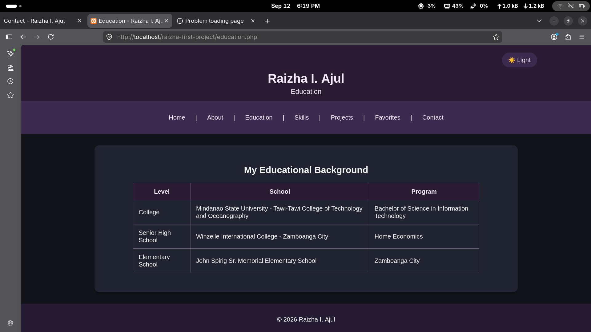
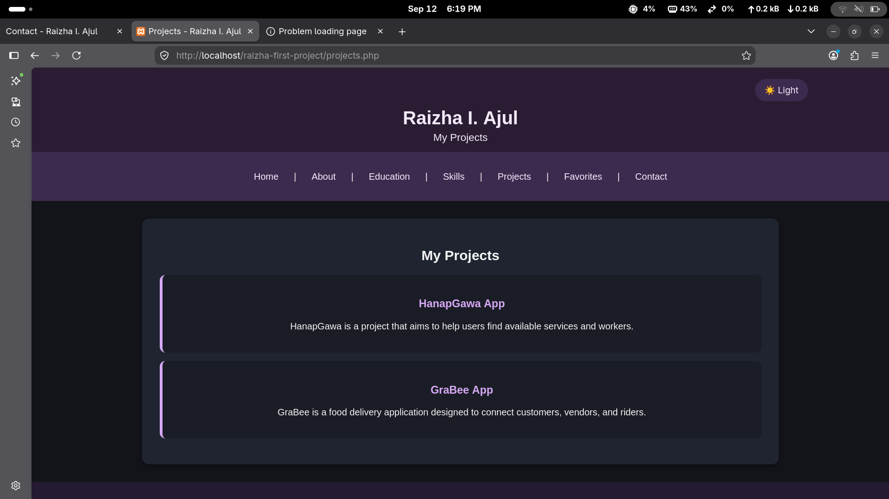
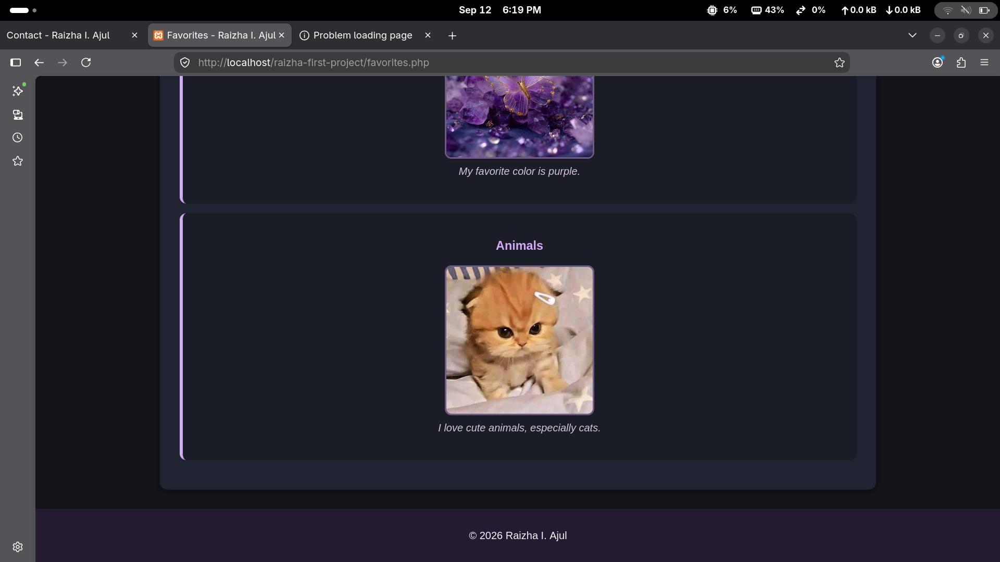
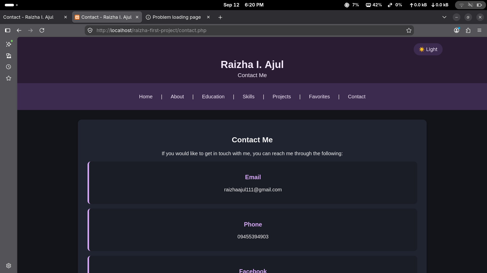

Personal Portfolio Website

This is a simple personal portfolio website created for my Web Systems and Technologies course. It was developed using PHP, HTML, and CSS and was run locally using XAMPP.

The website contains pages for my Home, About, Education, Skills, Projects, Favorites, and Contact information.

## Web 2.0 Screenshots

The following screenshots show the different pages of my Web 2.0 .

